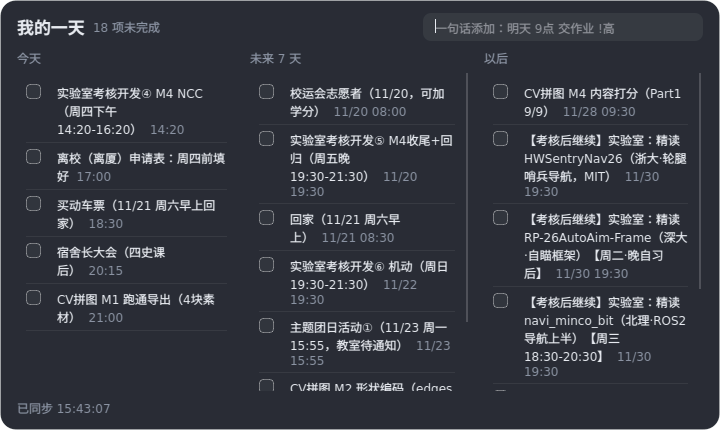

# 桌面任务挂件（Windows / Ubuntu）

贴在壁纸上的半透明任务看板。**不是网页** —— 原生 Qt 窗口（PySide6），
置底、不进任务栏、不抢焦点，平时沉在所有软件下面，切回桌面就能看见。



## 它满足的桌面行为（`method1.md` v2 要求）

| 需求 | 实现 |
|---|---|
| 置底，永不盖住其他软件 | `Qt.WindowStaysOnBottomHint` |
| 贴在桌面上：无标题栏、圆角、半透明 | `Qt.FramelessWindowHint` + `WA_TranslucentBackground` + 圆角面板 |
| 不进任务栏 / Alt-Tab | `Qt.Tool` |
| 显示时不抢焦点 | `WA_ShowWithoutActivating` |
| 锁定后点击穿透（纯展示） | `WA_TransparentForMouseEvents`（Windows 再加 `WS_EX_TRANSPARENT|WS_EX_LAYERED`） |

## 跑起来

```bash
# Windows（PowerShell）
py -3 -m venv .venv
.venv\Scripts\activate
pip install PySide6
python taskboard.py

# Ubuntu
python3 -m venv .venv && . .venv/bin/activate
pip install PySide6
python taskboard.py
```

无界面自检（CI / 服务器上用）：

```bash
QT_QPA_PLATFORM=offscreen python taskboard.py --selftest
```

会打印窗口 flags、拉到几条任务、存一张 `selftest.png`，并跑 3 条解析用例。

### 凭据

优先环境变量，其次 `~/.config/vikunja/env`，最后脚本同目录 `.env`：

```
VIKUNJA_URL=https://tasks.example.com
VIKUNJA_USER=your_user
VIKUNJA_PASS=your_password
VIKUNJA_PROJECT=2
```

## 怎么用

- **看**：三列 —— 今天 / 未来 7 天 / 以后，逾期标红。
- **勾**：点任务前的方框 → `POST /api/v1/tasks/{id}` 回写完成，卡片立即消失；手机上打勾，这里 10 秒内同步。
- **加**：右上角输入框回车。支持 `明天 9点 交作业`、`周五 17:00 交实验报告`、`11-25 20:30 组会`、`3天后 交材料`、`!高` / `!低` 优先级；认不出日期就建无日期任务。
- **拖**：按住空白处拖动窗口，位置记在 `QSettings`（下次启动原位）。
- **托盘图标**（右键）：锁定（点击穿透）/ 透明度 100%·96%·85%·70% / 退出。

## 开机自启

**Ubuntu**

```bash
mkdir -p ~/.config/autostart
cat > ~/.config/autostart/taskboard.desktop <<EOF
[Desktop Entry]
Type=Application
Name=TaskBoard
Exec=/home/$USER/taskboard/.venv/bin/python /home/$USER/taskboard/taskboard.py
X-GNOME-Autostart-enabled=true
EOF
```

**Windows**：`Win+R` → `shell:startup` → 放一个指向 `pythonw.exe taskboard.py` 的快捷方式（用 `pythonw` 才没有黑框）。

## 三个坑（改代码前先看）

1. **`QWidget` 默认会用调色板底色铺一块**（浅色主题下是白的），压在深色面板上会让浅色文字全被吃掉。
   面板样式里必须写 `QWidget { background: transparent; }`，滚动区和它的 viewport 也要单独压成透明。
2. **富文本颜色不会继承样式表**：`QLabel` 里用 HTML 时颜色要走调色板，深色面板上会变成深灰。
   所以标题/时间的颜色都写死在 `<span style='color:#...'>` 里。
3. **更新任务必须是 `POST /api/v1/tasks/{id}` 且全量回传字段**：少传 `due_date` 会被静默清空（PUT 还会 405）。
   列表接口每页 50 条，`Vikunja.tasks()` 会翻页拉全。

## 结构

```
taskboard.py  单文件：配置 / Vikunja 客户端 / 中文时间解析 / 挂件窗口 / 托盘
tests/test_parse.py  解析器用例（python tests/test_parse.py）
```

## 已知取舍

- 单项目（`VIKUNJA_PROJECT`），不做多项目切换；
- 没有编辑/删除按钮，只做「看 + 加 + 完成」；
- Wayland 下 `WindowStaysOnBottomHint` 由合成器决定，可能表现为普通窗口——X11 / Windows 上按预期置底。
